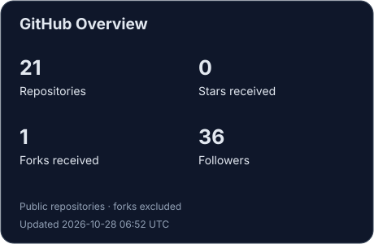
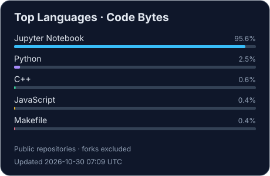

<h1 align="center">Hi, I'm Nizar 👋</h1>

<strong>Machine Learning Engineer · AI Data Scientist</strong> Malang, Indonesia

  <a href="https://www.linkedin.com/in/akhmad-nizar-zakaria-8a692b229/">LinkedIn</a> ·
  <a href="mailto:akhmad.nizar021@gmail.com">Email</a> ·
  <a href="https://github.com/Valerie6048?tab=repositories">Repositories</a>

I build AI solutions from data pipelines and model development to deployment on Azure. My work spans Generative AI, predictive modeling, and computer vision, with applications in healthcare and marketing analytics.

- **Experience:** ML Engineer at Devdat, building RAG applications, forecasting models, and analytics infrastructure.
- **Generative AI:** clinical trial matching, context-aware recommendations, and structured data extraction from clinical research forms.
- **Predictive modeling:** time-series forecasting with prediction ranges, seasonal adjustments, and marketing budget allocation using Bayesian optimization.
- **Computer vision:** video content analysis, creative attribute analysis, and deduplication using Azure AI services.
- **Education:** Bachelor of Computer Engineering, Brawijaya University (2024).

## Languages & Tools

| Area | Technologies |
| --- | --- |
| Programming | Python · C++ · C |
| Machine learning & data | scikit-learn · pandas · TensorFlow · XGBoost · CatBoost |
| Computer vision | OpenCV · Azure AI Vision · Azure Custom Vision · Azure Video Indexer · Google Cloud Vision API |
| AI & deployment | Azure Machine Learning · Azure AI Foundry · Azure Functions · Streamlit |
| Storage & databases | Azure Blob Storage · Google Cloud Storage · BigQuery · Azure Database for PostgreSQL |

## Selected Projects

- **[Cafe Recommendation System](https://github.com/Bangkit-Capstone-C23-PS256)** — Content-based cafe recommendations in Malang using preferences such as ambiance, price, and amenities, integrated into a mobile application with cloud and mobile teams.
- **[Crypto & Stock Market Screener](https://github.com/Valerie6048/yfinance-project)** — A Streamlit dashboard combining market charts, sentiment analysis, and an AI agent for market insights.

## GitHub Stats

Updated daily via <a href="https://github.com/Valerie6048/Valerie6048/actions/workflows/update-stats.yml">GitHub Actions</a>. Repository, star, fork, and language totals cover owned public repositories, excluding forks. Language shares reflect code bytes reported by GitHub, not proficiency. Private and organization work is not included.
